<h1 align="center">Tetromino</h1>

<p align="center">
  
  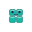
  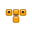
  
  
  
  
</p>

<p align="center">
  Seven tiny, friendly, animated four-block icons, in six animations.<br>
  One self-contained SVG per icon · no JavaScript · no dependencies · 1.5–3&nbsp;KB each.
</p>

<p align="center">
  <a href="https://lituus-io.github.io/tetromino/"><b>Live demo</b></a>
</p>

<p align="center">
  <a href="LICENSE"></a>
  <a href="https://www.npmjs.com/package/@lituus-io/tetromino"></a>
</p>

---

## Contents

- [What's included](#whats-included)
- [Motions](#motions)
- [Install](#install)
- [Usage](#usage)
  - [As an image](#as-an-image)
  - [Inline SVG](#inline-svg)
  - [JavaScript / TypeScript](#javascript--typescript)
  - [CSS background or `mask`](#css-background-or-mask)
- [Customising](#customising)
- [Sizes and legibility](#sizes-and-legibility)
- [Performance](#performance)
- [Accessibility](#accessibility)
- [Browser support](#browser-support)
- [Pro pack](#pro-pack)
- [Building from source](#building-from-source)
- [Contributing](#contributing)
- [License](#license)

## What's included

Tetrominoes are the seven shapes you can make by joining four equal squares edge to edge. This library draws each one as a small character with eyes, a smile and a soft highlight. The default icons play a gentle **drop** animation: the shape falls in, squashes on landing, settles, and blinks. Five more [motions](#motions) (spin, turn, wobble, squash and melt) come with every shape, for 42 animated icons in all.

| Shape | File | Default colour |
|:-----:|------|----------------|
|  **I** | `svg/tetromino-i.svg` | `#f43f5e` rose |
|  **O** | `svg/tetromino-o.svg` | `#14b8a6` teal |
|  **T** | `svg/tetromino-t.svg` | `#f59e0b` amber |
|  **S** | `svg/tetromino-s.svg` | `#8b5cf6` violet |
|  **Z** | `svg/tetromino-z.svg` | `#0ea5e9` sky |
|  **J** | `svg/tetromino-j.svg` | `#84cc16` lime |
|  **L** | `svg/tetromino-l.svg` | `#ec4899` pink |

Every file:

- is a single standalone SVG with its CSS animation embedded, so it works anywhere an image does
- draws on a 32 × 32 `viewBox` and scales cleanly from 16 px to any size
- can be recoloured with one CSS variable (`--c`)
- can be offset in time with `--delay` so a row of icons moves in a wave
- stops moving for people who have reduced motion turned on in their system settings
- has a static frame you can request with `#still`

**[See the live demo →](https://lituus-io.github.io/tetromino/)** (every shape, every size, the motions, the still frame and recolouring)

## Motions

Each shape also comes in five looping motions, in [`svg/motion/`](svg/motion/). The file name is `tetromino-<shape>-<motion>.svg`, and every control below (`--c`, `--delay`, `--loops`, `#still`) works the same way.

<table>
<tr><th></th><th>I</th><th>O</th><th>T</th><th>S</th><th>Z</th><th>J</th><th>L</th></tr>
<tr><td><b>Spin</b><br><code>motion/spin</code></td><td></td><td></td><td></td><td></td><td></td><td></td><td></td></tr>
<tr><td><b>Turn</b><br><code>motion/turn</code></td><td></td><td></td><td></td><td></td><td></td><td></td><td></td></tr>
<tr><td><b>Wobble</b><br><code>motion/wobble</code></td><td></td><td></td><td></td><td></td><td></td><td></td><td></td></tr>
<tr><td><b>Squash</b><br><code>motion/squash</code></td><td>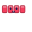</td><td>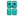</td><td>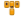</td><td>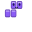</td><td>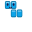</td><td>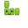</td><td>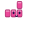</td></tr>
<tr><td><b>Melt</b><br><code>motion/melt</code></td><td></td><td></td><td></td><td></td><td></td><td></td><td></td></tr>
</table>

```html

```

## Install

**CDN (no install).** Link a file straight from jsDelivr. Pin a version tag in production:

```html

```

**npm.**

```sh
npm install @lituus-io/tetromino
```

**Download.** Copy the files you want from [`svg/`](svg/) and [`svg/motion/`](svg/motion/). There's nothing else to install.

## Usage

### As an image

```html


<!-- static frame, no motion -->

```

It also works in Markdown, which is how this README shows its icons:

```md

```

> An SVG loaded through `` is sandboxed, so CSS variables on the page can't reach it. To recolour an icon, inline it (below) or edit `fill="var(--c,#…)"` in your copy of the file.

### Inline SVG

Paste the file contents into your HTML. Then page CSS can recolour it, delay it, or freeze it:

```html
<span style="--c:#0f766e; --delay:.3s">
  <!-- contents of tetromino-o.svg -->
</span>

<!-- class="still" on the <svg> element gives a static frame -->
<svg class="still" …>…</svg>
```

Each drop icon defines its cell graphic with `id="c"`. If you inline **several different drop icons on one page**, rename that id in each copy (for example `c` → `c-t` and `href="#c"` → `href="#c-t"`) so they don't pick up each other's colours. The [demo page](https://lituus-io.github.io/tetromino/) shows how this is done. The motion files already use unique ids and class names, so any number of them can share a page as they are.

### JavaScript / TypeScript

The package exports each icon as a raw SVG string, so it needs no loader, plugin or framework.

```js
import shapes, { t, names, colors, dataUri } from '@lituus-io/tetromino';

el.innerHTML = t;                       // inline SVG markup
img.src = dataUri('l');                 // data: URI for  or CSS
names;                                  // ['i','o','t','s','z','j','l']
colors.s;                               // '#8b5cf6'
shapes[name];                           // look up by name
```

Types ship with the package (`type Shape = 'i' | 'o' | 't' | 's' | 'z' | 'j' | 'l'`).

To import the files directly in a bundler (Vite, webpack and others):

```js
import tUrl from '@lituus-io/tetromino/svg/tetromino-t.svg';
import tSpinUrl from '@lituus-io/tetromino/svg/motion/tetromino-t-spin.svg';
```

**React example**

```jsx
import { shapes } from '@lituus-io/tetromino';

export function Block({ shape = 't', size = 32, color, delay }) {
  return (
    <span
      role="img"
      aria-label={`${shape.toUpperCase()} block`}
      style={{ display: 'inline-block', width: size, height: size, '--c': color, '--delay': delay }}
      dangerouslySetInnerHTML={{ __html: shapes[shape].replace('width="32" height="32"', 'width="100%" height="100%"') }}
    />
  );
}
```

(The markup comes from this package, not from users, so `dangerouslySetInnerHTML` is safe here.)

### CSS background or `mask`

```css
.badge::before {
  content: "";
  display: inline-block;
  width: 1.25em;
  height: 1.25em;
  background: url("tetromino-z.svg") center / contain no-repeat;
}
```

## Customising

All the controls are CSS custom properties or classes. They take effect when the SVG is **inlined**:

| Control | Example | Effect |
|---------|---------|--------|
| `--c` | `--c: #0f766e` | Fill colour of the four cells. The highlight and edge shading adapt to it. |
| `--delay` | `--delay: .45s` | Starts the animation later. Stagger a row by giving each icon a slightly larger delay. |
| `--loops` | `--loops: 1` | How many times the animation plays (default `infinite`). Use `1` for a one-time entrance. |
| `#still` | `tetromino-t.svg#still` | Static frame. Works with `` too. |
| `.still` | `<svg class="still">` | Static frame for inline SVG. |

A staggered row:

```html
<div class="row">
  <span style="--delay:0s">…i…</span>
  <span style="--delay:.15s">…o…</span>
  <span style="--delay:.3s">…t…</span>
</div>
```

Every animation loops every 2.4 s. The drop takes up the first ~55% of each cycle and the shape rests for the rest.

## Sizes and legibility

| Rendered size | What you see |
|---------------|--------------|
| ≥ 24 px | Full character: cells, highlight, eyes, smile, blink |
| < 20 px | The face is hidden automatically, leaving just the shape and colour, which is what makes it recognisable at that size |

Set any `width`/`height`. The drawing scales from its `viewBox`.

## Performance

The icons are built to be light:

- **Only `transform` and `opacity` are animated**, the cheapest properties to animate, and no JavaScript runs. CI rejects any keyframe that animates another property.
- **Measured cost.** A browser repaints an animated SVG inside an `` on the main thread while it moves. In Chrome on an M-series Mac, all seven shapes on one page used about 3–4% of the main thread, and the same seven shapes repeated 300 times used about 10%. Repeats of one file are cheap because the browser shares a single copy. Inlining an SVG's markup in your HTML instead of using `` lets the browser animate it on the GPU, at close to no main-thread cost.
- **Small files.** About 1.4 KB per drop icon and 1.6–2.9 KB per motion before compression (well under 1 KB gzipped). No fonts, images or scripts are pulled in.
- **No JavaScript** is needed to animate. The optional JS entry point only hands you the SVG strings.
- **Browsers skip off-screen work.** Animations inside `` elements that aren't visible aren't painted.
- **Each cycle mostly rests.** The drop takes about 1.3 s of each 2.4 s loop. Set `--loops: 1` when you only need it once.
- **Many different animated icons as `` add up.** Each distinct animated file shown through `` is repainted separately, so a page with dozens of different ones is better served by inline SVG.

## Accessibility

- Each SVG has `role="img"` and an `aria-label` ("T block", and so on). Give `` tags a meaningful `alt`, or `alt=""` if the icon is purely decorative.
- Motion stops for users who have reduced motion turned on (`prefers-reduced-motion: reduce`). You don't need to do anything.
- The animation never flashes, and each cycle ends in a long rest.

## Browser support

All current evergreen browsers (Chrome, Edge, Firefox, Safari on desktop and mobile). The icons use only standard SVG 1.1 shapes, `<use href>`, and CSS animations embedded in the SVG. Older environments that don't run SVG CSS animations show a correct static icon.

## Pro pack

This repository is the **free core**: the seven base shapes with the drop animation and the five motions as animated SVG, MIT-licensed, yours to use anywhere.

A paid **Pro pack** extends the same characters. It is sold separately under a commercial license and is not part of this repository:

- **Dance moves:** every character dances (bop, shimmy, twist, wave-through, robot, disco, hop-step and spin-out), synced to your tempo with one `--bpm` variable
- **Status animations:** loader, progress, success, error, sleepy and thinking
- **Extra expressions:** nine moods plus winter, halloween and party looks
- **Scenes:** wave, stack loader, line clear, conversation, conga line, dance-off and a dance floor
- **Lottie, GIF, WebP and PNG exports** of every animation (the free motions included) for apps, slides, chat and anywhere SVG doesn't fit
- **Components:** a Web Component with React and Vue wrappers, with eye-follow, squish, drag, scroll reveal and a toggle switch

<!-- Replace with your storefront link(s) when the pack is live. -->
The Pro pack is coming soon. Watch or star this repository to get notified when it launches.

Purchases support continued development of the free core.

## Building from source

The drop icons, the JS entry point and the demo page are generated by one standard-library Python script. The motion SVGs in `svg/motion/` are committed as they are.

```sh
git clone https://github.com/lituus-io/tetromino.git
cd tetromino
python3 scripts/build.py   # writes svg/, index.js, index.d.ts, docs/index.html
npm test                   # validates SVGs, size budget and the JS entry point
```

Requirements: Python 3.8+ and Node 18+ (Node is only needed for `npm test`).

Repository layout:

```
svg/               the seven drop icons (generated)
svg/motion/        the 35 motion icons
index.js           ESM entry: SVG strings + helpers (generated)
index.d.ts         TypeScript types (generated)
docs/index.html    demo page (generated)
scripts/build.py   the generator, the single source of truth
scripts/check.py   validation run in CI
```

Edit `scripts/build.py`, not the generated files. CI rebuilds everything and fails if the committed output doesn't match.

## Contributing

Issues and pull requests are welcome, especially rendering bugs, accessibility improvements and size reductions. Please:

1. Change `scripts/build.py`, then run `python3 scripts/build.py` and `npm test`.
2. Commit the regenerated files with your change.
3. Keep each SVG under the budget enforced by `scripts/check.py` (1.6 KB for drop icons, 3 KB for motions).

New animations and expressions are part of the Pro pack, so pull requests that add them to this repository can't be accepted.

## License

Copyright © 2026 lituus-io. All rights reserved.
Author: spicyzhug@gmail.com

The code and icons in this repository are released under the [MIT License](LICENSE). The Pro pack is licensed separately.
